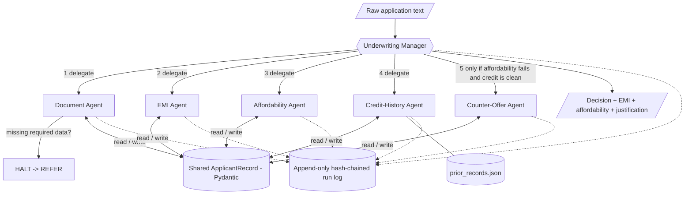

# Loan Underwriting Agents

*A manager-worker system for clear, rule-based loan decisions.*

[](https://www.python.org/)
[](https://github.com/microsoft/semantic-kernel)
[](#quick-start)

## What it does

Give the system a loan application as text. It returns **SANCTION**, **DECLINE** or **REFER**, with the EMI, an affordability verdict and a one-paragraph justification.
Field extraction uses regular expressions by default, with optional Groq extraction.
Loan calculations and decisions use deterministic Python rules.

## How it works

1. The Manager delegates document extraction and checks for missing required fields. Missing data halts processing and is referred.
2. If required fields are present, specialist agents calculate EMI, check affordability, and review credit history.
3. If affordability fails and there are no credit red flags, the Counter-Offer Agent checks alternatives.
4. The Manager applies the decision table and records the result.



The steps have real dependencies: affordability needs the EMI, and the decision needs both affordability and credit results. One Manager owns control flow and the final decision. Each agent has its own Semantic Kernel and plugin, which keeps its tools isolated.

## Agents and tools

| Agent | Role | Tools |
|---|---|---|
| Document Agent | Extracts application fields and checks required data | `extract_fields`, `validate_fields`, `llm_extract_fields` |
| EMI Agent | Calculates reducing-balance EMI and totals | `compute_emi`, `amortisation_summary` |
| Affordability Agent | Applies the 40% obligation-to-income cap | `compute_obligation_ratio`, `max_affordable_emi`, `check_rule` |
| Credit-History Agent | Looks up prior records and evaluates flags | `lookup_prior_record`, `evaluate_red_flags` |
| Counter-Offer Agent | Finds and verifies passing alternatives | `max_principal_for_emi`, `verify_offer` |
| Underwriting Manager | Applies policy and writes the justification | `apply_policy`, `compose_justification` |

## Decision rules

Rules are checked in order; the first matching rule decides the outcome.

| Rule | Condition | Outcome |
|---|---|---|
| R1 | Required application data is missing | REFER |
| R2 | Hard credit flag: bankruptcy, default, or score below 600 | DECLINE |
| R3 | Credit review flag, including score 600–649 or at least 3 late payments in 12 months | REFER |
| R4 | Affordability rule fails | DECLINE; passing counter-offers may be attached |
| R5 | All checks pass | SANCTION |

## Shared memory and run log

- A Pydantic `ApplicantRecord` holds application fields, EMI, affordability, credit findings, offers and the final decision.
- Field ownership limits which agent can update each part of the shared record.
- `data/prior_records.json` supplies the Credit-History Agent’s lookup data; it is loaded into memory when that agent starts.
- `logs/run_log.jsonl` stores events as append-only JSON Lines linked by SHA-256 hashes. `verify()` checks the chain.

## Failures handled

- Missing income, amount or tenure halts the workflow; the application is referred without guessing.
- A worker or tool exception is logged, and the Manager refers the application instead of crashing.

## Counter-offer (Group of 3)

- **reduce_amount:** largest amount, rounded down to Rs 1,000, that passes at the requested tenure.
- **extend_tenure:** same requested amount at the 84-month maximum, only if it passes the 40% rule.
- Offers are independently verified and are considered only after affordability fails and credit is clean.

## Optional Groq extractor

Set `GROQ_API_KEY` in `.env` to enable optional Groq extraction. The Document Agent sends the application text to Groq and validates the returned JSON; missing values are not guessed. If no key is set, it uses the regex extractor. API, timeout or response errors also fall back to regex. **EMI, affordability, credit rules, decisions and counter-offers remain deterministic Python.**

## Quick start

### Windows PowerShell

```powershell
git clone https://github.com/PrakharPurwar12/loan-underwriting-agents.git
Set-Location loan-underwriting-agents
py -m venv .venv
.\.venv\Scripts\Activate.ps1
python -m pip install -r requirements.txt
Copy-Item .env.example .env
python demo.py
pytest -v
```

### macOS or Linux

```bash
git clone https://github.com/PrakharPurwar12/loan-underwriting-agents.git
cd loan-underwriting-agents
python3 -m venv .venv
source .venv/bin/activate
python -m pip install -r requirements.txt
cp .env.example .env
python demo.py
pytest -v
```

For regex-only runs, leave `GROQ_API_KEY` empty in `.env`. To use Groq, replace the example value with your own key. Do not commit `.env`.

## Sample output

Trimmed from `python demo.py counter_offer`:

```text
Decision      : DECLINE
Computed EMI  : Rs 32,502.44
Affordability : FAIL (62.5% of income vs 40% cap)
Counter-offer : reduce_amount: Rs 584,000.00 / 36 months / EMI Rs 18,981.43
Counter-offer : extend_tenure: Rs 1,000,000.00 / 84 months / EMI Rs 16,860.67
```

## Project structure

```text
loan_uw/
  agents/       Manager and specialist agents, one module each
  config.py     Policy settings and paths
  finance.py    Deterministic loan calculations
data/           Prior credit records
docs/           Architecture details
tests/          Offline scenario tests
demo.py         Run all scenarios or one named scenario
demo.ipynb      Notebook demo with multi-agent traces
```

## Group members

| Registration Number | Roll Number | Name |
|---|---|---|
| [Add registration number] | [Add roll number] | [Add name] |

## Course

CSE476 CA2, Q2 — Lovely Professional University
